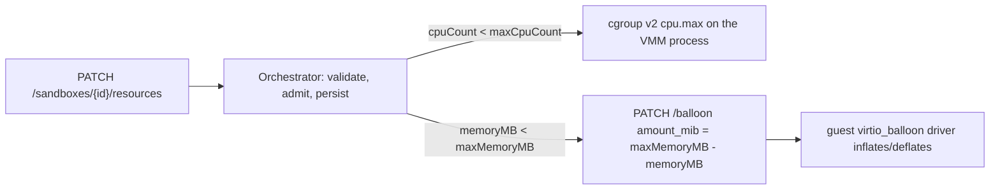

# Sandbox Resources and Live Resize

A sandbox has two sets of CPU and memory numbers:

| Field | Meaning | Changes when |
|-------|---------|--------------|
| `maxCpuCount`, `maxMemoryMB` | The **VM shape**: vCPUs and guest memory Firecracker was configured with when the VM first booted (template build or cold start) | Never, for the life of that VM and every restore of it |
| `cpuCount`, `memoryMB` | The **effective limits**: how much of the shape the sandbox may use | On create (`cpuCount`/`memoryMB` in `NewSandbox`) and live, through `PATCH /sandboxes/{sandboxID}/resources` |

Live resize moves the effective limits anywhere inside the VM shape. It does
not change the shape. Node accounting (`allocatedCPU`, `allocatedMemoryBytes`),
lifecycle events, and `cpuCount`/`memoryMB` in `GET /sandboxes/{sandboxID}`
and the sandbox lists report the effective limits.

The feature is off by default; enable it per node with
[`[resize]`](../../configuration/reference.md#resize).

## Why the shape is fixed

AgentENV runs Firecracker 1.15 (`config/deps_manifest.toml`). What it offers
for changing a VM's resources:

| Mechanism | Firecracker 1.15 | Used |
|-----------|------------------|------|
| vCPU hotplug | Not supported. `PUT /machine-config` is pre-boot only and the API has no vCPU hotplug endpoint | No |
| Changing guest memory size | `PUT /machine-config` is pre-boot only | No |
| Restoring a snapshot onto a different shape | Not possible: the VM state file holds every vCPU's registers and the guest memory regions, so a restore recreates the original shape | No |
| virtio-mem memory hotplug (`/hotplug/memory`) | Available since 1.14, but the device and its hotpluggable region must be configured before `InstanceStart`, so only VMs booted with it can grow | Not yet, see [Future work](#future-work) |
| virtio-balloon (`PATCH /balloon`) | Works on running and restored VMs | Memory limits |
| cgroup v2 `cpu.max` on the VMM process | Host kernel feature, independent of Firecracker | CPU limits |

Every VM AgentENV boots already has a virtio-balloon device (it enables free
page reporting), so memory limits work for templates built by earlier
releases too. A real shape change needs a new VM: capture the rootfs, then
cold-start or build a template with the larger shape. Processes do not
survive that; it is a reboot, not a live resize.

## How limits are enforced



**CPU.** A sandbox below its vCPU count gets its own cgroup, and its
Firecracker process moves into it with
`cpu.max = "<cpuCount × 100000> 100000"`: `cpuCount` vCPUs worth of CPU time
per 100 ms period, shared by the vCPU threads and the VMM's device emulation
threads. Raising `cpuCount` back to the vCPU count writes `max`. Sandboxes
never limited below their vCPU count never get a cgroup.

The cgroups live in a threaded subtree under the server's own cgroup:

```text
<server cgroup>              domain threaded; keeps the server's processes
└── agentenv-sandboxes       threaded, +cpu
    └── <sandbox id>         threaded, cpu.max
```

A cgroup that holds processes cannot enable controllers for its children
(cgroup v2 "no internal processes"), but a threaded subtree is exempt, so the
server does not have to move out of its container cgroup and runtimes can
still exec into it. Memory and I/O stay accounted to the server's cgroup as
before. This needs a writable, delegated cgroup v2 hierarchy with the `cpu`
controller: a Kubernetes container running privileged (as the bundled
DaemonSet does), or a systemd unit with `Delegate=yes`. When the server cannot
set it up at startup, it logs a warning and only memory can be resized.

**Memory.** The balloon is asked to hold `maxMemoryMB - memoryMB`. The guest's
virtio-balloon driver allocates that much memory and hands it to Firecracker,
which releases it on the host; deflating gives it back.

**Lifecycle.**

- *Create from a template or snapshot*: `cpuCount`/`memoryMB` default to the
  snapshot's shape and may not exceed it. The limits are enforced before the
  create returns. A snapshot captured from a resized sandbox records the VM
  shape, not the limits, so sandboxes launched from it get whole VMs unless
  they ask otherwise; the inherited balloon target is reset on launch.
- *Cold start* (`POST /sandboxes-cold`): `cpuCount`/`memoryMB` define the VM
  shape; the sandbox can then be resized down and back up.
- *Pause/resume*: the limits are kept and enforced again on resume (the CPU
  cgroup belongs to the VMM process, which is new after a resume).
- *Fork*: children inherit the source's shape and limits.
- *Template builds* always run with their whole VM.

## API

Create below the template's shape (the node needs `[resize].enabled`):

```bash
curl -X POST "$AENV_API_URL/v2/sandboxes" -H "X-API-Key: $AENV_API_KEY" \
  -H 'Content-Type: application/json' \
  -d '{"templateID": "my-template", "cpuCount": 2, "memoryMB": 4096}'
```

Resize a running sandbox; an omitted field keeps its value:

```bash
curl -X PATCH "$AENV_API_URL/sandboxes/$SANDBOX_ID/resources" \
  -H "X-API-Key: $AENV_API_KEY" -H 'Content-Type: application/json' \
  -d '{"cpuCount": 4, "memoryMB": 8192}'
```

The response, also returned by `GET /sandboxes/{sandboxID}/resources`:

```json
{
  "cpuCount": 4, "memoryMB": 8192,
  "maxCpuCount": 8, "maxMemoryMB": 16384,
  "cpuQuota": 4,
  "balloonTargetMB": 8192, "balloonActualMB": 6144,
  "memoryState": "converging"
}
```

The PATCH returns once the VMM enforces the new limits. The guest then moves
the balloon; `memoryState` reports `converged`, `converging`, or
`unobservable` (sandbox not running, or a VM booted without balloon
statistics, see `[machine.balloon].stats_polling_interval_s`). A balloon
deflated to zero is reported `converged`.

| Status | When |
|--------|------|
| 200 | The VMM enforces the new limits |
| 400 | Resize is disabled on the node; a value is below its minimum (`cpuCount` 1, `memoryMB` `[resize].min_memory_mib`) or above the VM shape; or `cpuCount` is below the vCPU count on a node without the CPU quota. Retrying the same request cannot succeed |
| 404 | No such sandbox |
| 409 | The sandbox is not running, another operation holds it, or the growth exceeds `[resize].max_cpu_allocated_percent` / `max_memory_allocated_percent` of the node |
| 500 | The VMM rejected the limits; the previous ones were applied again |

`NewSandbox`/`NewSandboxV2` return 400 for the same validation failures.

## Limits

- **The shape is the ceiling.** A sandbox cannot grow past the template it was
  launched from. To allow growth, build templates with headroom and launch
  smaller. Headroom is not free: the guest kernel reserves about 1.6% of the
  VM's memory for page metadata (64 bytes per 4 KiB page) whatever the limit,
  and idle vCPUs cost little but not nothing.
- **The guest still sees every vCPU.** The CPU limit is CPU time, not CPU
  count: `nproc` reports `maxCpuCount`, thread pools sized from it
  oversubscribe the quota, and a workload that hits the quota is throttled at
  100 ms granularity, which shows up as latency.
- **Memory limits need the guest's cooperation.** The balloon works through
  the guest's `virtio_balloon` driver; a guest that unloads it keeps its
  memory. Whether the limit is hard depends on how the VM first booted:
  - `deflate_on_oom = true` (every VM booted before this change, and the
    default) lets the guest take balloon memory back under memory pressure, so
    the limit is advisory. The guest's `MemTotal` does not shrink.
  - With `[machine.balloon].deflate_on_oom = false` the guest cannot, so a
    workload that outgrows the limit is OOM-killed inside the guest, as on a
    VM of that size. Templates must be rebuilt to get this.
- **Shrinking below the working set does not complete.** The balloon can only
  take memory the guest can free; `memoryState` stays `converging` (with
  statistics) while the guest holds on to it.
- **Progress needs balloon statistics,** which are fixed at first boot
  (`[machine.balloon].stats_polling_interval_s`). Without them the API reports
  the target but not how much the balloon holds.
- **Only running sandboxes can be resized.** Resume, then resize.
- **Admission is node-local and best-effort.** The scheduler places creates;
  each node checks only growth it is asked for, against its own CPUs and
  `MemTotal`, and concurrent creates are not counted until they register.
- **CPU limits need the cgroup v2 quota.** Without it, only memory can be
  resized and `cpuCount` must equal the vCPU count.
- **Turning `[resize]` off** with limited sandboxes on the node keeps their
  balloon targets (they live in the VM state) but drops their CPU quotas at the
  next resume.
- Disk size is not part of live resize.

## Future work

- **Growing past the boot memory with virtio-mem.** Boot templates with a
  hotpluggable region (`PUT /hotplug/memory`) and plug memory on demand. The
  bundled guest kernel (`vmlinux-6.1.175`) already has the virtio-mem driver
  and memory hot-remove (`virtio_mem_probe`, `offline_and_remove_memory` are
  in its symbol table). The missing pieces are VMM-side: configuring the
  device at template build, the `memhp_default_state` boot argument, and
  teaching the memory snapshot pipeline (dirty-range packaging and
  ublk-backed restore) the hotplug region, which Firecracker stores as sparse
  holes.
- **Accurate `nproc`.** Offline the guest's surplus vCPUs through envd
  (`/sys/devices/system/cpu/cpuN/online`; the guest kernel has CPU hotplug) in
  addition to the quota. Guest root can bring them back, so it complements the
  quota rather than replacing it.
- **Shape change by reboot.** Capture the rootfs and cold-start a new VM with
  the requested shape, for callers that accept losing process state.
